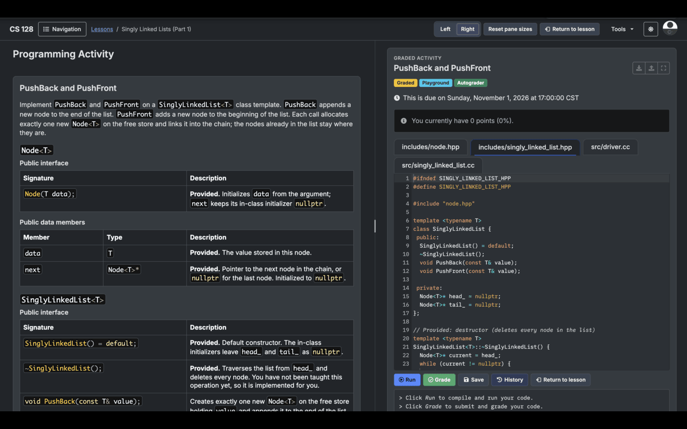

# CS128 SideBySide

This is a Chrome extension that puts CS128 lessons and workspaces side by side. I found it a bit annoying to keep scrolling up and down, so this extension allows you to open the workspace in a separate pane, move it to either size, and resize the pane as you work.
 

## Installation

1. Clone the repo.
2. Open `chrome://extensions`.
2. Turn on Developer mode.
3. Select Load unpacked and choose the repo
4. Open a lesson on `https://cs128.org` and click `Open in side panel` beside History. Use Left or Right in the main navbar to change its position. Click Return to lesson in the navbar or beside the active workspace to close split view.

Drag the center divider to resize the panes. Click `Reset pane sizes` beside the pane controls to restore a 50/50 split.
